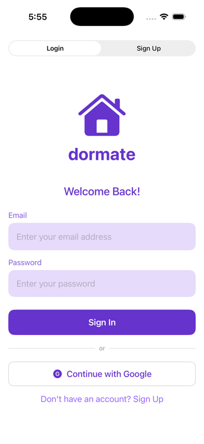
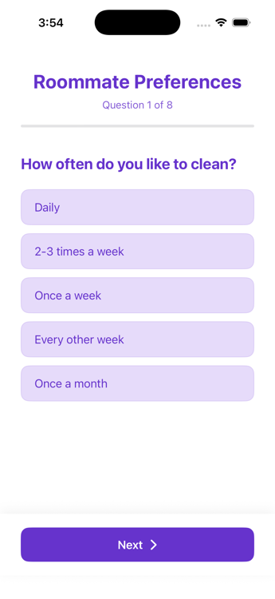
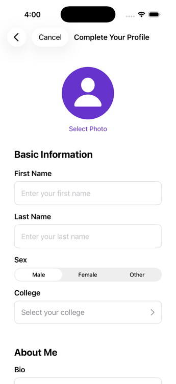

# Dormate

An iOS app that matches college students with compatible roommates, built in
SwiftUI with a Firebase backend.

**Status:** prototype. I built it in spring 2025 to learn SwiftUI and Firebase,
and returned to it in 2026 to rework the authentication flow and add Google
Sign-In. It has not been released on the App Store.

## Features

1. **Sign-up** with email or Google.
2. **Living-preferences survey** covering cleanliness, chore style, sleep
   schedule, study location, social frequency, room temperature, and guests.
3. **Profile setup** with a bio, interests, a photo, and a college selected from
   a searchable directory of US institutions.
4. **Matching.** Candidates are limited to the user's college and ranked by a
   compatibility score: living preferences account for 60% and shared interests
   for 40%, measured with Jaccard similarity over interest tags.
5. **Messaging.** A mutual like creates a chat thread, and messages update in
   real time through Firestore listeners.

## Screenshots

| Login | Living survey | Profile setup |
|:---:|:---:|:---:|
|  |  |  |

## Architecture

- **SwiftUI** with an MVVM structure: models, service classes for Firestore
  access, view models, and views grouped by feature.
- **Navigation** is driven by app state from a single root view, which routes
  users through sign-in, the survey, and profile setup before the main tab view.
- **Firebase Auth** for email and Google sign-in. On first Google sign-in, the
  app creates the user's Firestore profile from the Google account.
- **Firestore** for users, matches, chats, and messages; **Firebase Storage** for
  profile photos.

## Running locally

Create a Firebase project, add its `GoogleService-Info.plist` to the app target
(the file is excluded from the repository), and open `dormate2.xcodeproj` in
Xcode.

## Known limitations

- Match scoring and mutual-match writes run on the client. They should move to
  Cloud Functions so users cannot alter scores or create matches directly.
- Firestore security rules are still in development mode and must be restricted
  before any real users.
- Survey answers are mapped to fixed 1 to 5 scales with hand-tuned weights. With
  usage data, the weights could be learned instead.
- Filtering is limited to college and gender; a production version would need
  user-configurable filters.
